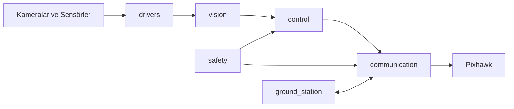

# İSAS Yazılım

CELEBİ–UMMAN ana araç, Mini ROV ve su üstü kontrol istasyonu için yazılım çalışma alanı.

> **Durum:** Altyapı ve entegrasyon aşaması. Araç üzerinde çalışacak bileşenler, donanım-in-the-loop testlerinden geçmeden görev-kritik kabul edilmez.

## Kapsam

- Jetson Nano üzerinde görüntü işleme ve üst seviye görev mantığı
- Pixhawk/MAVLink haberleşmesi ve durum takibi
- Kamera ve sensör sürücüleri
- Ana araç ile Mini ROV arasındaki komut/telemetri katmanı
- Su üstü kontrol istasyonu uygulamaları
- Failsafe, watchdog ve sistem sağlık kontrolleri

## Mimari



`safety` katmanı haberleşme timeout, sızıntı alarmı ve kritik sistem durumu gibi girdileri izler. Güvensiz durumda hareket komutu üretmek yerine kontrollü nötr duruma geçiş hedeflenir.

## Dizin Yapısı

```text
src/isas/
├── vision/          Görüntü işleme
├── control/         Görev ve hareket kontrolü
├── communication/   MAVLink, ağ ve telemetri
├── drivers/         Kamera ve sensör arayüzleri
├── safety/          Watchdog ve failsafe politikaları
└── common/          Ortak veri modelleri ve yardımcılar

apps/                Çalıştırılabilir uygulama katmanı
configs/             Sürümlenebilir, gizli bilgi içermeyen ayarlar
tools/jetson/        Jetson kurulum ve ağ araçları
scripts/             Geliştirme/üretim yardımcıları
tests/               Unit, entegrasyon ve donanım testleri
docs/                Yazılım mimarisi ve protokoller
```

## Hızlı Başlangıç

```bash
python -m venv .venv
source .venv/bin/activate        # Windows: .venv\Scripts\activate
python -m pip install -e ".[dev]"
pytest
python -m isas
```

## Konfigürasyon İlkesi

- Gizli bilgiler ve cihaz parolaları `.env` veya GitHub Secrets içinde tutulur.
- Repoya yalnızca güvenli örnek değerler içeren `.env.example` eklenir.
- Donanım pinleri ve seri portlar açık biçimde sürümlenir; saha makinesine özel yollar ayrı override dosyasında tutulur.

## Değişiklik Süreci

Issue → branch → pull request → otomatik test → ekip incelemesi → squash merge.

Güvenlik/failsafe davranışını etkileyen PR'lar bench testi ve ikinci kişi incelemesi olmadan birleştirilmez.
